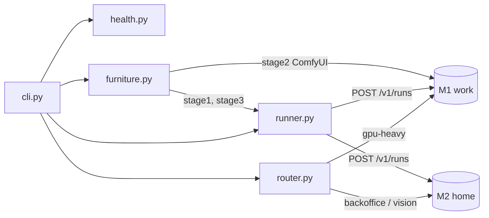

# scripts/cluster — оркестратор work + home

Две Windows-машины в связке **Hermes peer**:

| Имя | Хост | Роль |
| --- | --- | --- |
| **work** | DESKTOP-J25T962 | RTX 4070 Ti SUPER 16 ГБ, ComfyUI `:8188`, Hermes, Ollama |
| **home** | DESKTOP-6ECJBT6 | RTX 3060 12 ГБ, ComfyUI, OpenClaw `:18789`, Ollama (114 тегов), Obsidian |

Связь M1 → M2: `https://desktop-6ecjbt6.tailcaa609.ts.net` (Tailscale Funnel), Bearer `HERMES_PEER_HOME_KEY` / `HERMES_PEER_HOMEPEER_KEY` из `%LOCALAPPDATA%/hermes/.env`.

## Схема



## Требования

- Python **3.11+**
- Только **stdlib** (в рантайме кластера)
- `pytest` — для тестов в `tests/test_cluster_*.py`

## CLI

```bash
python -m scripts.cluster.cli health
python -m scripts.cluster.cli route --profile gpu-heavy
python -m scripts.cluster.cli run --peer home --prompt "Сводка продаж за неделю"
python -m scripts.cluster.cli parallel \
  --home-prompt "Обнови Obsidian дашборд" \
  --work-prompt "Оцени загрузку VRAM"
python -m scripts.cluster.cli furniture --task-file task.json
```

## Маршрутизация (`router.py`)

| Профиль | Машина |
| --- | --- |
| `gpu-heavy` | work |
| `backoffice`, `vision-asset`, `audio-music`, `obsidian` | home |
| неизвестный | home (fallback с обоснованием) |

## Переменные окружения

- `HERMES_PEER_WORK_URL` — локальный Hermes (по умолчанию `http://127.0.0.1:8765`)
- `HERMES_PEER_HOME_KEY`, `HERMES_PEER_HOMEPEER_KEY` — или строки в `hermes/.env`
- `COMFYUI_PROD` — ComfyUI work (по умолчанию `http://127.0.0.1:8188`)
- `OLLAMA_HOST` — Ollama (по умолчанию `http://127.0.0.1:11434`)

## Протокол runner

1. `GET /api/sessions?title=Bot+Chat&include_hidden=1` → `session_id`
2. При отсутствии — `POST /api/sessions`
3. `POST /v1/runs` + заголовок `Idempotency-Key`
4. Опрос `GET /v1/runs/{run_id}` до терминального статуса или `output` / `error`